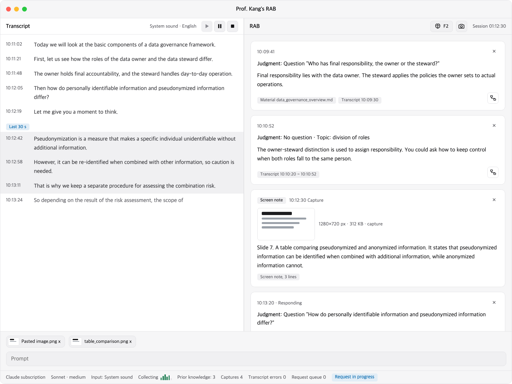

<h1 align="center">Prof. Kang's RAB</h1>

<a href="README.md">한국어</a> | English

<strong>Retrieval-Augmented Brain</strong>

An app that gathers live transcription, prior knowledge and the screen during meetings and classes to augment the user's brain and knowledge.

This app was inspired by a technique that AI expert Prof. Jangmook Kang introduced in his lecture of September 19, 2026: using live recording and a laptop to augment brain function during meetings. It brings that technique into an app, gathering live transcription, prior knowledge and the screen during meetings and classes to augment the user's brain and knowledge.

Mockups of every screen: <a href="https://claude.ai/artifact/SeosX2oTCiqQ6ctYebBzAW">https://claude.ai/artifact/SeosX2oTCiqQ6ctYebBzAW</a>

## What this project provides

The core value of this project lies in presenting a method, and the form of its process, for widening the channel through which information flows from the outside world to the brain and for extending context beyond the brain.

This app is built to run on macOS with Claude. If you use another operating system or model provider, you are welcome to port it to fit your own environment and needs. [AGENT_INSTALL.md](AGENT_INSTALL.md#porting-to-another-environment) describes the parts to port, using Windows as the example.

## Quick start

You can leave the installation to an AI coding agent. On a Mac with [Claude Code](https://code.claude.com/docs), say:

> Install Prof. Kang's RAB on this Mac. Follow AGENT_INSTALL.md in `https://github.com/NSU-AISEC/nsu-kangs-rab`, and stop and ask me at any step that needs my account, keys or permissions.

The agent follows [AGENT_INSTALL.md](AGENT_INSTALL.md), checks the tools and builds the app. It stops at the steps only you can do: signing in to Claude Code (`/login`), entering the key in the app if you use the API key method, waiting while macOS prepares the speech recognition language model the first time you use a language, and granting macOS permissions (screen recording, system sound). The agent does not handle Claude Code's credentials or your API key. Questions about installing, using, troubleshooting and porting are answered by the agent from the same document. To install by hand, follow its procedure. The app calls the model through the Claude Code CLI (`claude -p`), so the subscription method needs Claude Code and its login, and the API key method needs the key you enter in the app.

## Credits and license

This project is released under the MIT License. The license text is in `LICENSE` at the repository root.

Material from other projects is kept in `third_party/`, each with its own license file:

- `third_party/diagram-design/`: a specific version of diagram-design (MIT license, <https://github.com/cathrynlavery/diagram-design>), used by the diagram feature. The folder has its `LICENSE` and `THIRD_PARTY_LICENSES.md`.
- `third_party/awesome-design-md/`: a copy of one design document from awesome-design-md (MIT license, <https://github.com/voltagent/awesome-design-md>), with its `LICENSE`.

The screens use PySide6 (Qt for Python) as a library. PySide6 is licensed under the LGPL v3 (<https://doc.qt.io/qtforpython-6/licenses.html>). The app installs it as a dependency with `uv sync` and does not modify it.
