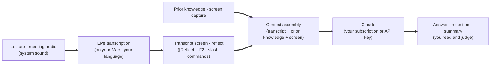
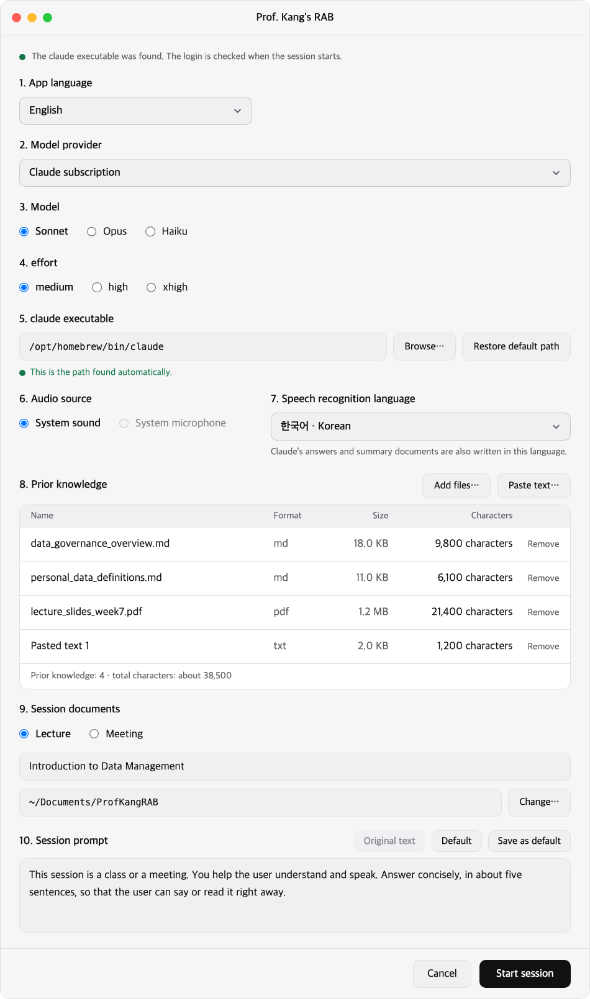
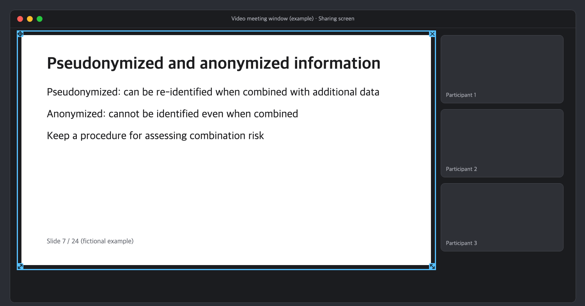
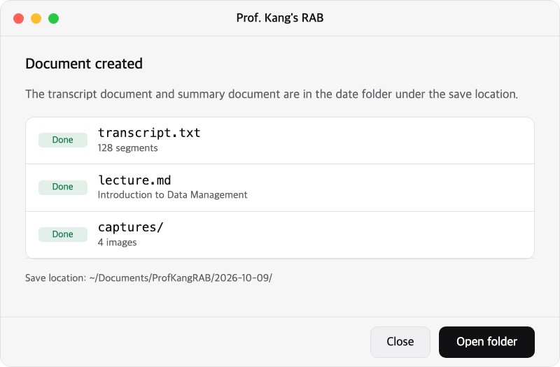

<p align="center"></p>

<h1 align="center">Prof. Kang's RAB</h1>

<p align="center"><a href="README.md">한국어</a> | English</p>

<p align="center"><strong>Retrieval-Augmented Brain</strong></p>

<p align="center">A Mac app that keeps you from missing what is said in class and meetings, and combines what you know with AI answers so you can respond right away.</p>

It started from the meeting method that AI expert Prof. Jangmook Kang introduced in his lecture of September 19, 2026. During a meeting or class, it gathers live transcription, prior knowledge and the screen to augment the user's brain and knowledge.

<p align="center"></p>

## When to use it

- **When the professor speeds up in an online class.** Speech becomes text on screen as it is spoken, so you can reread a sentence you missed.
- **When a question suddenly comes to you in a meeting.** Press the [Reflect] button (the brain icon, with its key shown beside it) or F2, and Claude reads the last 30 seconds of conversation, recognizes the question, and shows an answer grounded in the material you prepared.
- **Even when no question was asked.** You get suggestions: the issue under discussion, a missing viewpoint, a question or remark you could raise.
- **When you need to point at something that exists only on a slide or whiteboard.** Capture one screen and hand it to the model, and that content becomes part of the conversation context.

This is not an app that speaks for you. It is an aid that you read and judge.

## Quick start

You can leave the installation to an AI coding agent. On a Mac with [Claude Code](https://code.claude.com/docs), say:

> Install Prof. Kang's RAB on this Mac. Follow AGENT_INSTALL.md in `https://github.com/NSU-AISEC/nsu-kangs-rab`, and stop and ask me at any step that needs my account, keys or permissions.

The agent follows [AGENT_INSTALL.md](AGENT_INSTALL.md), checks the tools and builds the app. It stops at the steps only you can do: signing in to Claude Code (`/login`), entering the key in the app if you use the API key method, waiting while macOS prepares the speech recognition language model the first time you use a language, and granting macOS permissions (screen recording, system sound). The agent does not handle Claude Code's credentials or your API key. To install by hand, follow [Before you start](#before-you-start) and [Install](#install).

**Using Windows or another AI?** The app needs macOS 26.0 or later (speech recognition uses the SpeechTranscriber built into macOS 26) and has been verified on Apple Silicon Macs only. A Windows version is a port, not an install; see [For Windows users](#for-windows-users). You may install with another agent, but the app calls the model through the Claude Code CLI (`claude -p`), so the subscription method needs Claude Code and its login, and the API key method needs the key you enter in the app.

## How it works

<!--
This Mermaid is the source of the figure below (docs/assets/readme/en/flow.svg). The figure is generated from it with diagram-design. (Arrows are written as thick arrows `==>` so they do not collide with the symbol that closes an HTML comment.)

-->

<p align="center"></p>

1. **Listen.** It collects system sound (including the audio of video meetings) and transcribes it on your Mac in the language you choose for speech recognition. The audio never leaves it.
2. **Gather.** The transcript accumulates on screen, together with the prior knowledge you loaded in advance and the screens you captured.
3. **Ask.** Press once at the moment you need it, and the app selects as much context as is needed and queries Claude once. While you press nothing, it calls no model.
4. **Receive.** Answers, reflections and summaries pile up as cards. From a card that holds an answer you can also generate a diagram to see its structure at a glance.

## Screen tour

<p align="center"></p>

**Start session.** Choose lecture or meeting, the audio source, the model and prior knowledge, then start.

<p align="center"></p>

**Frame window.** Place it over a slide and only the inside of the frame is captured. The meeting window and slide in the picture are examples.

<p align="center"></p>

**End session.** The transcript document and the summary document are created in the session folder.

## Features

| Feature | What it does |
|---|---|
| Live transcription | Transcribes speech on your Mac in the speech recognition language you choose on the session start screen (nine languages: Korean, English, Japanese, Chinese (Mandarin), German, French, Spanish, Italian and Portuguese; the app itself is shown in Korean or English). It uses the SpeechTranscriber built into macOS 26. macOS downloads the language model the first time you use a language; the app shows the progress and no audio is sent. |
| One-press reflection | The [Reflect] button (the brain icon, with its key shown beside it) or F2 (the key inside the app window). Settings also lets you set a global key that works while another app is in front; it is empty by default and registered only while a session is open. If a question is recognized in the last 30 seconds it answers; otherwise it gives a reflection. The first line shows what the model based its judgment on. |
| Slash commands | `/answer` and `/summary` request directly with no judgment step. `/reflect` works like the [Reflect] button: Claude answers if it recognizes a question, and otherwise reflects. You can also ask freely in the input box. |
| Prior knowledge | Add md · txt · pdf · image files or paste text. Answers rest on the prior knowledge and the transcript, and it says it does not know when there is no basis. |
| Screen capture | Place the always-on-top transparent frame window over a slide and press the camera button (or the global Capture frame key you set in Settings) to capture only its inside and receive a screen note. You can also attach images by dragging them onto the input box or pasting them (up to 5). |
| Start, pause, stop | A session opens in the "Not started" state: nothing is collected or transcribed yet. Press [Play] to start audio collection; [Pause] and [Stop] are beside it. Reflect, questions, captures and attachments work even before the first Play. |
| Diagrams | One button on a card that holds an answer turns its content into a diagram (SVG). |
| Session documents | When you end a session, the transcript document and a key-points document (a lecture summary for lectures; agenda · discussion · decisions · action items for meetings) remain in the session folder. |
| Desktop app | See the transcript and answers in an app window, with no terminal. A menu bar icon shows the session state, and you choose light, dark or follow the system setting. |
| App language | The app screen is in Korean or English. Choose it in 1. App language at the top of the session start screen; it applies after you restart the app. |

You choose the model from Claude's Sonnet, Opus and Haiku, and the authentication from a Claude subscription or a Claude API key. The "System microphone" item of the audio source is visible on screen but cannot be selected in the Mac app for now.

## Why you can trust it

- **Audio never leaves your Mac.** Transcription runs on your Mac.
- **It does not hide what it sends.** The transcribed text and captured or attached images are sent to Claude (Anthropic) when you query. The app gives this notice at first launch.
- **It does not touch your login.** The app does not read the credentials that Claude Code stores. It runs an unmodified `claude` as a subprocess and calls it only with the authentication method you chose. If you use an API key, the key is kept in an app-only Keychain item.
- **It calls only when you press.** While there is no reflection, slash command, input, capture, diagram or session-end processing, there are no model calls.
- **Output stays in your folder.** Transcripts, summary documents, captures and diagrams are saved in a session folder at the location you chose.

## Before you start

| What you need | Why |
|---|---|
| **A Mac with macOS 26.0 or later** | Speech recognition uses the SpeechTranscriber built into macOS 26, and system sound capture uses macOS ScreenCaptureKit. The app was verified on Apple Silicon Macs only |
| **Xcode command-line tools** | The system sound capture helper is built with `swiftc` |
| **[uv](https://docs.astral.sh/uv/)** | Creates the Python environment and runs the app |
| **A Claude subscription or a Claude API key** | Used for model calls. A subscription needs you to be logged in to Claude Code; an API key is entered directly in the “Claude API key” box of 5. claude executable on the start screen. Usage is charged to your own account |
| **macOS permissions** | Capturing system sound needs the screen recording and system sound permissions. macOS asks when you press [Play] for the first time |
| **Basic terminal use** | Being able to paste and run commands is enough |

Every install step ends with a **Check**. When the check passes, go to the next step. The time a first install takes was not measured; we estimate that the app build takes most of it. The target platform is macOS 26.0 or later (verified on Apple Silicon Macs only).

## Install

### 1. Install the tools

| Tool | Purpose |
|---|---|
| Xcode command-line tools | Build the capture helper with `swiftc`. If missing, run `xcode-select --install` and install from the window that appears |
| uv | The Python environment and running the app. Follow the [uv installation guide](https://docs.astral.sh/uv/) (`brew install uv` if you have Homebrew) |
| [Claude Code](https://code.claude.com/docs) CLI | The app runs it as `claude -p` for model calls. To use the subscription method, run `claude` in a terminal and log in with `/login`. The API key method needs no login |

**Check:** `swiftc --version` and `uv --version` succeed. With the subscription method, `claude --version` also succeeds.

### 2. Get the code and install dependencies

```sh
git clone https://github.com/NSU-AISEC/nsu-kangs-rab nsu-kangs-rab
cd nsu-kangs-rab
uv sync
```

**Check:** The last line of the following command is `자체 점검: 실패 0건` (self-check: 0 failures). This check opens no window; it confirms that the app's modules and the speech recognition components can be imported.

```sh
uv run nsu-kangs-rab --self-check
```

### 3. Build the app

Build the Mac `.app` with the following command. It carries an ad-hoc signature; there is no distribution signing or notarization. The build bundles the capture helper and runs `--self-check` at the end; if the check fails, the build fails.

```sh
uv run --with pyinstaller==6.16.0 python tools/build_app.py <output folder>
```

**Check:** The command succeeds and `<output folder>/Prof. Kang's RAB.app` exists.

You can also run it for development without the `.app` (`uv run nsu-kangs-rab`). To capture system sound that way, first build the helper into the app settings folder.

```sh
uv run python tools/build_sck_helper.py
```

### 4. First launch

1. Open `Prof. Kang's RAB.app`.
2. Read the first-launch notice and confirm it. The transcribed text and captured or attached images are sent to Claude (Anthropic) when you query.
3. Choose the authentication method. The subscription uses the login from step 1; for an API key, choose Claude API in 2. Model provider and enter the key in the “Claude API key” box of 5. claude executable on the start screen; it is kept in an app-only Keychain item. The same section sets the path of the `claude` executable, and the app language is 1. App language.
4. Start a session and wait for the speech recognition language model. macOS prepares it the first time you use a language (a status chip "Preparing the speech recognition model" shows on the status bar, with a percentage added when macOS reports the progress; one test measured about 8 seconds for fr_FR, and macOS reported no percentage), and [Play] stays off until it is ready. No audio is sent.
5. Start a session, then press [Play] for the first time. macOS asks for screen recording and system sound permission at that moment, so allow them in the permission window. If the app shows a note saying that pressing Play may make macOS ask for the permission, that is expected. If you do not allow it, the collection state stays as it was ("Not started" or "Paused") and a note band appears above the transcript; allow Prof. Kang's RAB in System Settings > Privacy & Security > Screen & System Audio Recording, then press [Play] again. In one test it started collecting without restarting the app (the "Quit & Reopen" window of macOS was answered with [Later]); if it still does not collect, restart the app. If you denied it once, macOS may not show the window again (observed once, not confirmed), so allow it in System Settings.

**Check:** Start a session with system sound as the audio source and play some sound; the transcript accumulates in the main window.

## Update

```sh
cd nsu-kangs-rab && git pull && uv sync && uv run --with pyinstaller==6.16.0 python tools/build_app.py <output folder>
```

## Troubleshooting

The app shows errors from model calls and capture on an error card with the reason and an action. These are the symptoms you are most likely to meet.

| Symptom | Check · action |
|---|---|
| No login, or it has expired; or the authentication source differs from the selected method | With the subscription method, run `claude` in a terminal, log in with `/login`, then send again. With the API key method, restart the app, then check or re-enter the Claude API key in 5. claude executable on the start screen (the app opens only one session per run) |
| Could not find the `claude` executable | Install Claude Code from step 1, restart the app, then specify the path of the `claude` executable in 5. claude executable on the start screen. If the start screen already shows this as a band before you start, specify the path there without restarting |
| Screen recording permission does not stick after you rebuild the app (development builds) | Each new development build is a different app to macOS. In System Settings > Privacy & Security > Screen & System Audio Recording, remove the old "Prof. Kang's RAB" entry with [−], start a session with the new build, and press [Play]. If the file chooser of [+] does not show the app, drag the app from Finder into the list instead. Then turn the new entry on and press [Play] again; if it still does not collect, restart the app |
| A note band says a permission is needed when you press [Play] | In System Settings > Privacy & Security, allow Prof. Kang's RAB for the permission named in the band, then press [Play] again. If it still does not collect, restart the app |
| An error card says a permission is missing (for example a frame capture) | In System Settings > Privacy & Security, allow Prof. Kang's RAB for the permission named on the card, then restart the app |
| Capture does not resume by itself (audio capture could not start) | Check that the capture helper is present and restart the app. For a development run, build the helper with `build_sck_helper.py` from step 3 |
| Capture was interrupted | Check the output device (system sound). Capture resumes when the device recovers |
| Could not prepare the speech recognition model | Check the network connection, then click [Try again] on the card. If the card says macOS does not support the language, restart the app and choose another speech recognition language in 7. Speech recognition language on the start screen |
| Usage limit exceeded (the subscription limit is shared with other sessions) | Send the same request again after the limit resets |
| The app build ends with a `swiftc` error | Check the Xcode command-line tools from step 1 with `swiftc --version` |

## For Windows users

It was designed to be easy to move to Windows, and a Windows implementation can live in `src/windows/`. We would be grateful if you ported it to Windows and contributed to the repository.

- **Parts used as they are.** The core (model calls · context assembly · session documents) is in `src/mac/nsu_kangs_rab/core/` and does not even import Qt. The screens use Qt (PySide6), which runs on several operating systems.
- **Parts to port.** The platform-dependent modules in `src/mac/nsu_kangs_rab/platform/` are `audio` (system sound capture) · `stt` (speech recognition, using the SpeechTranscriber of macOS 26 only) · `capture` (screen capture) · `permissions` · `nswindow.py` (window handling).
- **Where to look first.** Candidate technologies and points to verify are WASAPI loopback capture (system sound), CPU transcription speed and Korean input. The implementation goes in `src/windows/`, which you create.

## Credits and license

This project is released under the MIT License. The license text is in `LICENSE` at the repository root.

Material from other projects is kept in `third_party/`, each with its own license file:

- `third_party/diagram-design/`: a specific version of diagram-design (MIT license, <https://github.com/cathrynlavery/diagram-design>), used by the diagram feature. The folder has its `LICENSE` and `THIRD_PARTY_LICENSES.md`.
- `third_party/awesome-design-md/`: a copy of one design document from awesome-design-md (MIT license, <https://github.com/voltagent/awesome-design-md>), with its `LICENSE`.

The screens use PySide6 (Qt for Python) as a library. PySide6 is licensed under the LGPL v3 (<https://doc.qt.io/qtforpython-6/licenses.html>). The app installs it as a dependency with `uv sync` and does not modify it.

## For developers

The repository name is `nsu-kangs-rab`. The design documents (decision records, the feature specification, the visual design and the team's working records) are not part of this repository; a source comment that names a path under `docs/` refers to them. The code layout for the Mac app is in [`src/mac/README.md`](src/mac/README.md).

The authentication principles the code keeps:

1. The app does not read Claude Code's credentials (the Keychain item Claude Code stored and `~/.claude/.credentials.json`) and does not use `claude setup-token`.
2. The app does not use the Agent SDK. It runs an unmodified `claude` as a `claude -p` subprocess.
3. The app does not use `--bare`, because `--bare` does not read the subscription login.
4. The app runs `claude -p` only with the method the user chose. With the subscription, it clears the variables that take priority over the subscription from the subprocess. With an API key, it keeps the key the user entered in an app-only Keychain item and passes it only as an environment variable of the subprocess. If the chosen method and the actual source of authentication differ, the session does not start.

The personal materials `sessions/` (test material during development) and `context/` (material to use as prior knowledge) are excluded from git.
