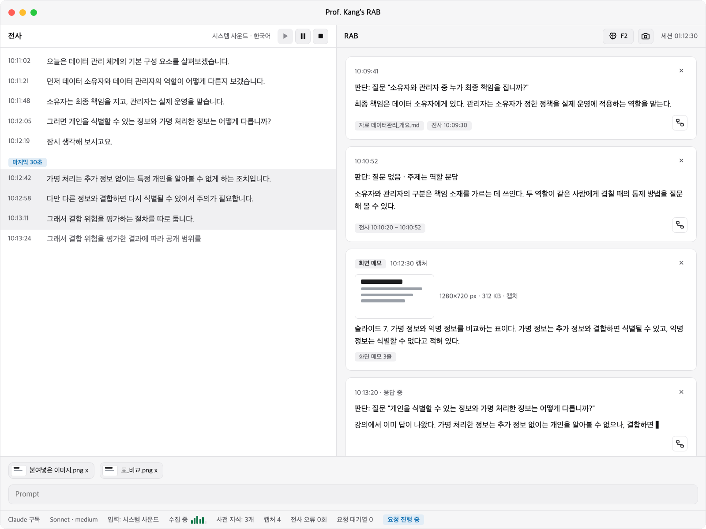
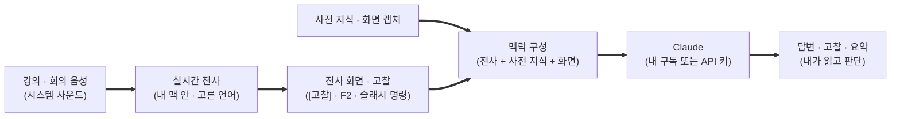
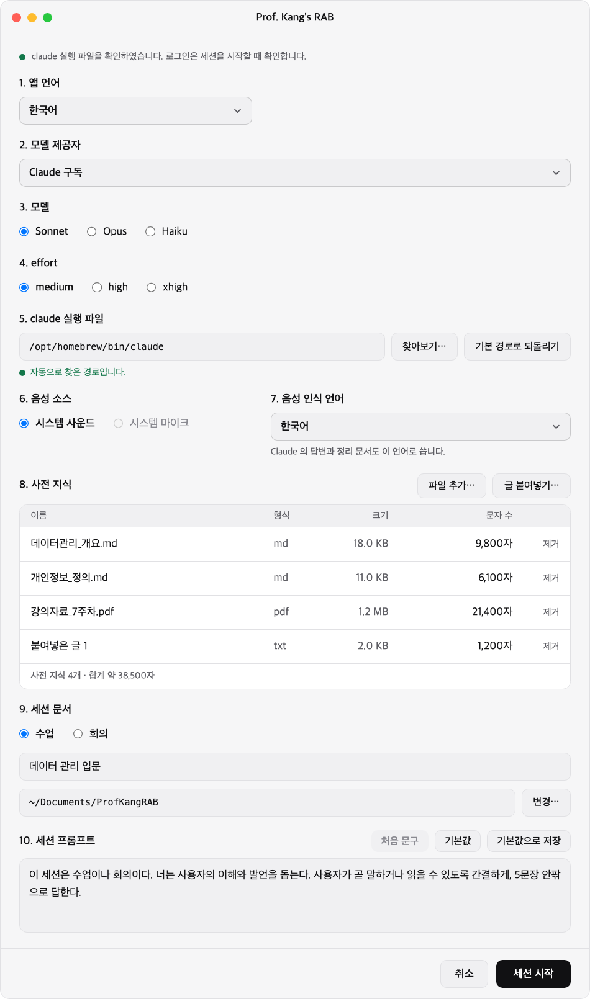
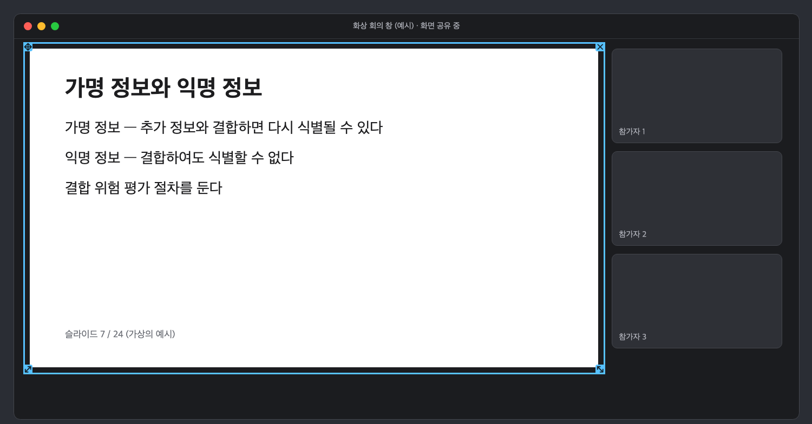
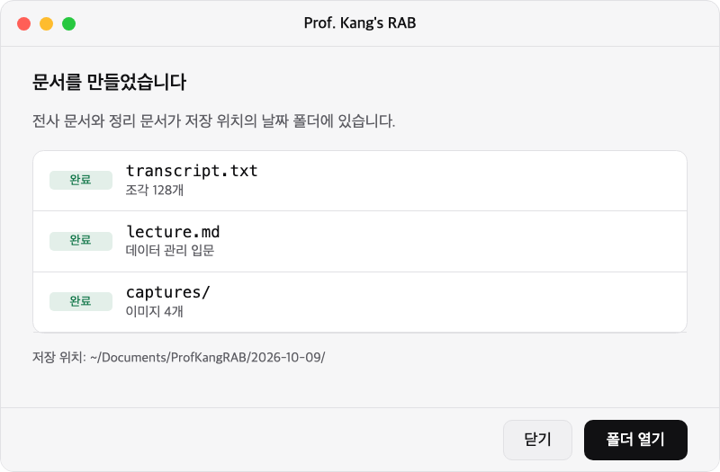

<p align="center"></p>

<h1 align="center">Prof. Kang's RAB</h1>

<p align="center"><a href="README.md">English</a> | 한국어</p>

<p align="center"><strong>Retrieval-Augmented Brain</strong></p>

<p align="center">수업과 회의에서 말을 놓치지 않고, 내가 아는 것과 AI 의 답을 합쳐 바로 대응하게 해 주는 맥용 앱.</p>

AI 전문가 강장묵 교수가 2026년 9월 19일 강의에서 소개한 회의 방식에서 출발했다. 회의와 수업 중에 실시간 전사 · 사전 지식 · 화면을 찾아 모아, 사용자의 두뇌와 지식을 증강한다.

<p align="center"></p>

## 이런 순간에 쓴다

- **화상 수업에서 교수의 말이 빨라질 때.** 말이 실시간으로 글이 되어 화면에 쌓이므로, 놓친 한 문장을 되짚어 읽을 수 있다.
- **회의에서 갑자기 질문이 나에게 올 때.** [고찰] 단추(두뇌 그림 아이콘, 옆에 단축키가 보인다. 또는 F2)를 누르면 방금 30초의 대화를 읽은 Claude 가 질문을 알아보고, 내가 준비해 둔 자료에 근거한 답을 보여 준다.
- **질문이 없는 때에도.** 지금 논의의 쟁점, 빠진 관점, 내가 꺼낼 수 있는 질문과 발언을 제안받는다.
- **슬라이드나 판서에만 있는 내용을 짚어야 할 때.** 화면 한 장을 캡처해 모델에 넘기면 그 내용이 대화의 맥락이 된다.

AI 가 나 대신 말하는 앱이 아니다. 내가 읽고 판단하는 보조이다.

## 빠른 시작

AI 코딩 에이전트에게 설치를 맡길 수 있다. [Claude Code](https://code.claude.com/docs) 를 쓰는 맥에서 다음과 같이 말한다.

> 이 맥에 Prof. Kang's RAB 를 설치해 줘. `https://github.com/NSU-AISEC/nsu-kangs-rab` 의 AGENT_INSTALL.md 를 따르고, 내 계정 · 키 · 권한 허용이 필요한 단계에서는 멈추고 나에게 물어봐.

에이전트는 [AGENT_INSTALL.md](AGENT_INSTALL.md)(영문)의 절차를 따라 도구를 확인하고 앱을 만든다. 사용자만 할 수 있는 단계에서는 멈춘다: Claude Code 로그인(`/login`), API 키 방식이면 앱에 키를 입력하는 일, 언어를 처음 쓸 때 macOS 가 음성 인식 언어 모델을 준비하는 동안의 기다림, macOS 권한 허용(화면 기록 · 시스템 사운드). 에이전트는 Claude Code 의 자격 증명과 사용자의 API 키를 다루지 않는다. 직접 설치하려면 [시작하기 전에](#시작하기-전에)와 [설치](#설치)를 따른다.

**Windows 를 쓰거나 다른 AI 를 쓰는가.** 이 앱은 macOS 26.0 이상이 필요하며(음성 인식이 macOS 26 에 내장된 SpeechTranscriber 를 쓴다) Apple Silicon 맥에서만 확인했다. Windows 용은 설치가 아니라 포팅이며 [Windows 사용자를 위한 안내](#windows-사용자를-위한-안내)에 있다. 다른 에이전트로 설치해도 되지만, 앱은 모델 호출에 Claude Code CLI(`claude -p`)를 쓰므로 구독 방식에는 Claude Code 와 그 로그인이 필요하고, API 키 방식에는 앱에 입력한 키가 필요하다.

## 어떻게 동작하는가

<!--
이 Mermaid 는 아래 그림(docs/assets/readme/flow.svg)의 원본이다. 그림은 이것으로 diagram-design 이 생성한다. (HTML 주석을 닫는 기호와 겹치지 않도록 화살표를 굵은 화살표 `==>` 로 적었다.)

-->

<p align="center"></p>

1. **듣는다.** 시스템 사운드(화상 회의의 음성 포함)를 수집해 내 맥 안에서 세션 시작 화면에서 고른 음성 인식 언어로 전사한다. 음성은 밖으로 나가지 않는다.
2. **모은다.** 전사는 화면에 쌓이고, 미리 넣어 둔 사전 지식과 캡처한 화면이 함께 준비된다.
3. **묻는다.** 필요한 순간에 한 번 누르면, 앱이 필요한 만큼의 맥락을 골라 Claude 에 한 번 질의한다. 누르지 않는 동안에는 모델을 호출하지 않는다.
4. **받는다.** 답변 · 고찰 · 요약이 카드로 쌓인다. 답을 담은 카드에서 다이어그램을 만들어 구조를 한눈에 볼 수도 있다.

## 화면 둘러보기

<p align="center"></p>

**세션 시작.** 수업인지 회의인지, 음성 소스와 모델, 사전 지식을 고르고 시작한다.

<p align="center"></p>

**액자 창.** 슬라이드 위에 놓으면 액자 안쪽만 캡처한다. 그림의 회의 창과 슬라이드는 예시이다.

<p align="center"></p>

**세션 종료.** 전사 문서와 정리 문서가 세션 폴더에 만들어진다.

## 주요 기능

| 기능 | 내용 |
|---|---|
| 실시간 전사 | 세션 시작 화면에서 고른 음성 인식 언어로 내 맥에서 전사한다(아홉 언어: 한국어 · 영어 · 일본어 · 중국어(만다린) · 독일어 · 프랑스어 · 스페인어 · 이탈리아어 · 포르투갈어. 앱 자체의 화면은 한국어 또는 영어이다). macOS 26 에 내장된 SpeechTranscriber 를 쓴다. 언어를 처음 쓸 때 macOS 가 언어 모델을 내려받으며, 앱이 진행 상황을 보이고 음성은 보내지 않는다. |
| 한 번의 고찰 | [고찰] 단추(두뇌 그림 아이콘, 옆에 단축키가 보인다) 또는 F2(앱 창 안의 키). 설정에서 다른 앱이 앞에 있을 때도 쓰는 전역 키를 지정할 수 있으며, 기본값은 비어 있고 세션 중에만 등록된다. 마지막 30초에서 질문이 인식되면 답하고, 아니면 고찰을 내놓는다. 첫 줄에 모델이 무엇으로 판단했는지 보인다. |
| 슬래시 명령 | `/답변` · `/요약` 은 판단 없이 바로 요청한다. `/고찰` 은 [고찰] 단추와 같게 동작하여, 질문이 인식되면 답하고 아니면 고찰한다. 입력창에 자유롭게 물을 수도 있다. |
| 사전 지식 | md · txt · pdf · 이미지 파일을 추가하거나 글을 붙여 넣는다. 답은 사전 지식과 전사에 근거하며, 근거가 없으면 모른다고 말한다. |
| 화면 캡처 | 항상 맨 위에 있는 투명한 액자 창을 슬라이드 위에 놓고 카메라 단추(또는 설정에서 지정한 전역 액자 캡처 키)를 누르면 그 안쪽만 캡처해 화면 메모를 받는다. 이미지는 입력창에 끌어다 놓거나 붙여 넣어 첨부할 수도 있다(최대 5장). |
| 시작 · 일시 정지 · 정지 | 세션은 "수집 전" 상태로 열리며 이때는 아무것도 수집 · 전사하지 않는다. [재생] 을 누르면 음성 수집이 시작되고, [일시 정지] 와 [정지] 가 그 옆에 있다. 고찰 · 질문 · 캡처 · 첨부는 처음 [재생] 전에도 쓸 수 있다. |
| 다이어그램 | 답을 담은 카드의 버튼 하나로 그 내용을 도식(SVG)으로 만든다. |
| 세션 문서 | 세션을 끝내면 전사 문서와 주요 내용 정리 문서(수업은 강의 요약본, 회의는 안건 · 논의 · 결정 · 액션 아이템)가 세션 폴더에 남는다. |
| 데스크톱 앱 | 터미널 없이 앱 창에서 전사와 답을 본다. 메뉴 막대의 아이콘이 세션 상태를 보여 주고, 밝은 화면 · 어두운 화면 · 시스템 설정 따르기를 고른다. |
| 앱 언어 | 앱 화면은 한국어 또는 English 이다. 세션 시작 화면 맨 위의 1. 앱 언어에서 고르며, 앱을 다시 시작하면 적용된다. |

모델은 Claude 의 Sonnet · Opus · Haiku 중에서, 인증은 Claude 구독 또는 Claude API 키 중에서 고른다. 음성 소스의 "시스템 마이크" 항목은 화면에 보이지만 맥용 앱에서는 지금 고를 수 없다.

## 믿고 쓸 수 있는 이유

- **음성은 내 맥을 떠나지 않는다.** 전사는 내 맥 안에서 한다.
- **보내는 것을 숨기지 않는다.** 전사된 글과 캡처 · 첨부 이미지는 질의할 때 Claude(Anthropic)로 전송된다. 첫 실행 때 이 사실을 고지한다.
- **내 로그인을 건드리지 않는다.** 앱은 Claude Code 가 저장한 자격 증명을 읽지 않는다. 수정하지 않은 `claude` 를 하위 프로세스로 실행하고, 사용자가 고른 인증 방식으로만 호출한다. API 키를 쓰면 키는 앱 전용 키체인 항목에 보관한다.
- **내가 누를 때만 호출한다.** 고찰 · 슬래시 명령 · 입력 · 캡처 · 다이어그램 · 세션 종료 처리가 없는 동안 모델 호출은 없다.
- **산출물은 내 폴더에 둔다.** 전사 · 정리 문서 · 캡처 · 다이어그램은 내가 정한 위치의 세션 폴더에 저장된다.

## 시작하기 전에

| 필요한 것 | 까닭 |
|---|---|
| **macOS 26.0 이상의 맥** | 음성 인식이 macOS 26 에 내장된 SpeechTranscriber 를 쓰고, 시스템 사운드 수집이 macOS 의 ScreenCaptureKit 을 쓴다. 앱은 Apple Silicon 맥에서만 확인했다 |
| **Xcode 명령줄 도구** | 시스템 사운드 수집 보조 프로그램을 `swiftc` 로 빌드한다 |
| **[uv](https://docs.astral.sh/uv/)** | Python 환경을 만들고 앱을 실행한다 |
| **Claude 구독 또는 Claude API 키** | 모델 호출에 쓴다. 구독은 Claude Code 에 로그인한 상태가 필요하고, API 키는 시작 화면의 5. claude 실행 파일 안 “Claude API 키” 칸에 직접 입력한다. 사용량은 본인의 계정에서 쓴다 |
| **macOS 권한 허용** | 시스템 사운드를 수집하려면 화면 기록 · 시스템 사운드 권한이 필요하다. 처음 [재생] 을 누를 때 macOS 가 묻는다 |
| **기본적인 터미널 사용** | 명령을 붙여 넣어 실행할 수 있으면 된다 |

각 설치 단계는 **확인** 으로 끝난다. 확인을 통과하면 다음 단계로 간다. 첫 설치에 걸리는 시간은 측정하지 않았다. 앱 빌드가 대부분을 차지할 것으로 추정한다. 대상 플랫폼은 macOS 26.0 이상의 맥이다(Apple Silicon 맥에서만 확인했다).

## 설치

### 1. 도구 설치

| 도구 | 용도 |
|---|---|
| Xcode 명령줄 도구 | `swiftc` 로 수집 보조 프로그램을 빌드한다. 없으면 `xcode-select --install` 을 실행하고 뜨는 창에서 설치한다 |
| uv | Python 환경과 앱의 실행. [uv 설치 안내](https://docs.astral.sh/uv/)를 따른다(Homebrew 가 있으면 `brew install uv`) |
| [Claude Code](https://code.claude.com/docs) CLI | 앱이 모델 호출에 `claude -p` 로 실행한다. 구독 방식을 쓰려면 터미널에서 `claude` 를 실행하고 `/login` 으로 로그인한다. API 키 방식은 로그인이 필요하지 않다 |

**확인:** `swiftc --version` 과 `uv --version` 이 성공한다. 구독 방식이면 `claude --version` 도 성공한다.

### 2. 코드 받기와 의존성 설치

```sh
git clone https://github.com/NSU-AISEC/nsu-kangs-rab nsu-kangs-rab
cd nsu-kangs-rab
uv sync
```

**확인:** 다음 명령의 마지막 줄이 `자체 점검: 실패 0건` 이다. 이 점검은 창을 열지 않고 앱의 모듈과 음성 인식 구성 요소를 가져올 수 있는지 확인한다.

```sh
uv run nsu-kangs-rab --self-check
```

### 3. 앱 만들기

맥용 `.app` 은 다음 명령으로 만든다. 임시 서명이 붙으며 배포용 서명 · 공증은 하지 않는다. 빌드는 수집 보조 프로그램을 함께 묶고, 끝에서 `--self-check` 를 실행하며 점검이 실패하면 빌드가 실패로 끝난다.

```sh
uv run --with pyinstaller==6.16.0 python tools/build_app.py <출력 폴더>
```

**확인:** 명령이 성공으로 끝나고 `<출력 폴더>/Prof. Kang's RAB.app` 이 있다.

개발용으로 `.app` 없이 실행할 수도 있다(`uv run nsu-kangs-rab`). 이때 시스템 사운드를 수집하려면 먼저 보조 프로그램을 앱 설정 폴더에 빌드한다.

```sh
uv run python tools/build_sck_helper.py
```

### 4. 첫 실행

1. `Prof. Kang's RAB.app` 을 연다.
2. 첫 실행 고지를 읽고 확인한다. 전사된 글과 캡처 · 첨부 이미지는 질의할 때 Claude(Anthropic)로 전송된다.
3. 인증 방식을 고른다. 구독은 1단계에서 로그인한 상태를 쓰고, API 키는 2. 모델 제공자에서 Claude API 를 고르고 시작 화면의 5. claude 실행 파일 안 “Claude API 키” 칸에 입력한다. 키는 앱 전용 키체인 항목에 보관한다. 같은 절에서 `claude` 실행 파일의 경로도 정하며, 앱 언어는 1. 앱 언어에서 정한다.
4. 세션을 시작하고 음성 인식 언어 모델을 기다린다. 언어를 처음 쓸 때 macOS 가 모델을 준비하며(상태 표시줄에 "음성 인식 모델을 준비하는 중입니다" 칩이 보이며, macOS 가 진행률을 알리면 퍼센트가 붙는다. 한 시험에서 fr_FR 은 약 8초가 걸렸고 macOS 는 퍼센트를 알리지 않았다), 준비가 끝나기 전에는 [재생] 이 꺼져 있다. 이때 음성은 보내지 않는다.
5. 세션을 시작한 뒤 처음 [재생] 을 누른다. 이때 macOS 가 화면 기록 · 시스템 사운드 권한을 물으므로 권한 허용 창에서 허용한다. 앱에 "[재생] 을 누르면 운영체제가 화면 기록 권한을 물을 수 있다" 는 안내가 보이면 정상이다. 허용하지 않으면 수집 상태는 그대로("수집 전" 또는 "일시 정지")이고 전사 창 위에 안내 띠가 나타난다. 시스템 설정 > 개인정보 보호 및 보안 > 화면 및 시스템 오디오 녹음에서 Prof. Kang's RAB 을 허용한 뒤 [재생] 을 다시 누른다. 한 시험에서는 앱을 다시 시작하지 않아도 수집이 시작되었다(macOS 의 "종료 및 다시 열기" 창에서 [나중에] 를 누름). 그래도 수집되지 않으면 앱을 다시 시작한다. 한 번 거부하면 macOS 가 창을 다시 띄우지 않을 수 있으므로(1회 관찰, 확인하지 않음) 시스템 설정에서 허용한다.

**확인:** 시스템 사운드를 음성 소스로 세션을 시작하고 소리를 재생하면 전사가 메인 창에 쌓인다.

## 업데이트

```sh
cd nsu-kangs-rab && git pull && uv sync && uv run --with pyinstaller==6.16.0 python tools/build_app.py <출력 폴더>
```

## 문제 해결

앱은 모델 호출과 수집의 오류를 오류 카드에 사유와 조치로 표시한다. 아래는 자주 만나는 증상이다.

| 증상 | 확인 · 조치 |
|---|---|
| 로그인이 없거나 만료되었다는 오류, 또는 인증 출처가 고른 방식과 다르다는 오류 | 구독 방식이면 터미널에서 `claude` 를 실행해 `/login` 으로 로그인한 뒤 다시 보낸다. API 키 방식이면 앱을 다시 시작해 시작 화면의 5. claude 실행 파일에서 키를 확인하거나 다시 입력한다(앱은 한 번 실행에 세션 하나만 연다) |
| `claude` 실행 파일을 찾지 못했다는 오류 | 1단계의 Claude Code 를 설치하고 앱을 다시 시작해 시작 화면의 5. claude 실행 파일에서 경로를 지정한다. 세션을 시작하기 전에 시작 화면의 띠로 먼저 알려 준 경우에는 다시 시작하지 않고 곧바로 경로를 지정한다 |
| 앱을 다시 만든 뒤 화면 기록 권한이 적용되지 않는다(개발 빌드) | 새 개발 빌드는 macOS 에 다른 앱으로 보인다. 시스템 설정 > 개인정보 보호 및 보안 > 화면 및 시스템 오디오 녹음에서 옛 "Prof. Kang's RAB" 항목을 [−] 로 지우고, 새 빌드로 세션을 시작해 [재생] 을 누른다. [+] 의 파일 선택 창에 앱이 보이지 않으면 Finder 에서 앱을 목록으로 끌어다 놓아 추가한다. 새 항목을 켠 뒤 [재생] 을 다시 누른다. 그래도 수집되지 않으면 앱을 다시 시작한다 |
| [재생] 을 눌렀을 때 권한이 필요하다는 안내 띠 | 시스템 설정의 개인정보 보호 및 보안에서 띠에 표시한 권한에 Prof. Kang's RAB 을 허용하고 [재생] 을 다시 누른다. 그래도 수집되지 않으면 앱을 다시 시작한다 |
| 필요한 권한이 없다는 오류 카드(예: 액자 캡처) | 시스템 설정의 개인정보 보호 및 보안에서 카드에 표시한 권한에 Prof. Kang's RAB 을 허용하고 앱을 다시 시작한다 |
| 음성 수집을 시작하지 못했다는 오류 | 수집 보조 프로그램이 있는지 확인하고 앱을 다시 시작한다. 개발용 실행이면 3단계의 `build_sck_helper.py` 로 보조 프로그램을 만든다 |
| 음성 수집이 중단되었다는 오류 | 출력 장치(시스템 사운드)를 확인한다. 장치가 복구되면 수집이 이어진다 |
| 음성 인식 모델을 준비하지 못한다 | 네트워크 연결을 확인한 뒤 카드의 [다시 시도] 를 누른다. macOS 가 그 언어를 지원하지 않는다는 카드이면 앱을 다시 시작해 시작 화면의 7. 음성 인식 언어에서 다른 언어를 고른다 |
| 사용 한도를 넘었다는 오류 | 구독 한도는 다른 Claude 세션과 공유된다. 한도가 풀린 뒤 같은 요청을 다시 보낸다 |
| 앱 빌드가 `swiftc` 오류로 끝난다 | `swiftc --version` 으로 1단계의 Xcode 명령줄 도구를 확인한다 |

## Windows 사용자를 위한 안내

Windows 로 옮기기 쉽도록 설계했으며, Windows 판 구현은 `src/windows/` 에 둘 수 있다. Windows 로 포팅하여 저장소에 기여해 주신다면 감사하겠다.

- **그대로 쓰는 부분.** 모델 호출 · 맥락 구성 · 세션 문서 같은 핵심은 `src/mac/nsu_kangs_rab/core/` 에 있으며 Qt 도 가져오지 않는다. 화면은 여러 운영체제에서 동작하는 Qt(PySide6)이다.
- **포팅할 부분.** 플랫폼에 의존하는 모듈은 `src/mac/nsu_kangs_rab/platform/` 의 `audio`(시스템 사운드 수집) · `stt`(음성 인식, macOS 26 의 SpeechTranscriber 만 사용) · `capture`(화면 캡처) · `permissions` · `nswindow.py`(창 처리)이다.
- **먼저 볼 곳.** 후보 기술과 확인할 점은 WASAPI 루프백 수집(시스템 사운드), CPU 전사 속도, 한글 입력이다. 구현은 `src/windows/` 에 두며, 이 폴더는 기여자가 만든다.

## 출처와 라이선스

이 프로젝트는 MIT 라이선스로 공개한다. 라이선스 전문은 저장소 루트의 `LICENSE` 에 있다.

다른 프로젝트의 자료는 `third_party/` 에 두며, 각각 자기 라이선스 파일을 가진다.

- `third_party/diagram-design/`: 다이어그램 기능이 쓰는 diagram-design(MIT 라이선스, <https://github.com/cathrynlavery/diagram-design>)의 특정 판이다. 그 폴더에 `LICENSE` 와 `THIRD_PARTY_LICENSES.md` 가 있다.
- `third_party/awesome-design-md/`: awesome-design-md(MIT 라이선스, <https://github.com/voltagent/awesome-design-md>)의 설계 문서 한 편의 사본이며 그 `LICENSE` 를 함께 둔다.

화면은 PySide6(Qt for Python)를 라이브러리로 쓴다. PySide6 는 LGPL v3 라이선스이다(<https://doc.qt.io/qtforpython-6/licenses.html>). 앱은 `uv sync` 로 이것을 의존성으로 설치하며 수정하지 않는다.

## 개발자를 위한 안내

저장소 이름은 `nsu-kangs-rab` 이다. 설계 문서(결정 기록 · 기능 명세 · 시각 설계 · 팀의 작업 기록)는 이 저장소에 포함하지 않으며, 소스 코드의 주석이 `docs/` 아래의 경로를 가리키면 그 문서를 뜻한다. 맥 앱의 코드 구성은 [`src/mac/README.md`](src/mac/README.md) 에 있다.

코드가 지키는 인증 원칙은 다음과 같다.

1. 앱은 Claude Code 의 자격 증명(Claude Code 가 저장한 키체인 항목과 `~/.claude/.credentials.json`)을 읽지 않고, `claude setup-token` 을 쓰지 않는다.
2. 앱은 Agent SDK 를 쓰지 않는다. 수정하지 않은 `claude` 를 `claude -p` 하위 프로세스로 실행한다.
3. 앱은 `--bare` 를 쓰지 않는다. `--bare` 는 구독 로그인을 읽지 않기 때문이다.
4. 앱은 사용자가 고른 인증 방식으로만 `claude -p` 를 실행한다. 구독이면 구독보다 우선하는 변수를 하위 프로세스에서 지운다. API 키이면 사용자가 입력한 키를 앱 전용 키체인 항목에 보관하고 하위 프로세스의 환경 변수로만 넘긴다. 고른 방식과 실제 인증 출처가 다르면 세션을 시작하지 않는다.

개인 자료인 `sessions/`(개발 중 시험 자료)와 `context/`(사전 지식으로 쓸 자료)는 git 에서 제외한다.
